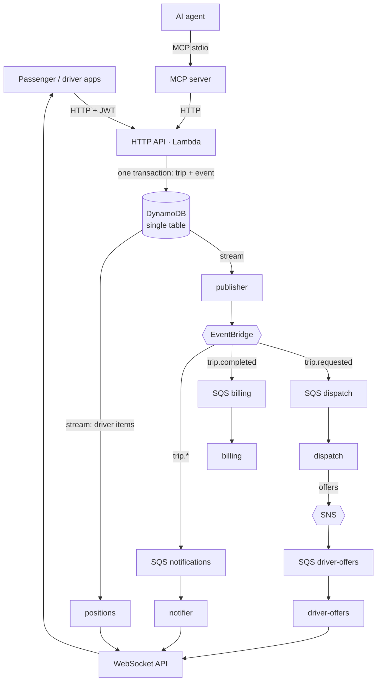
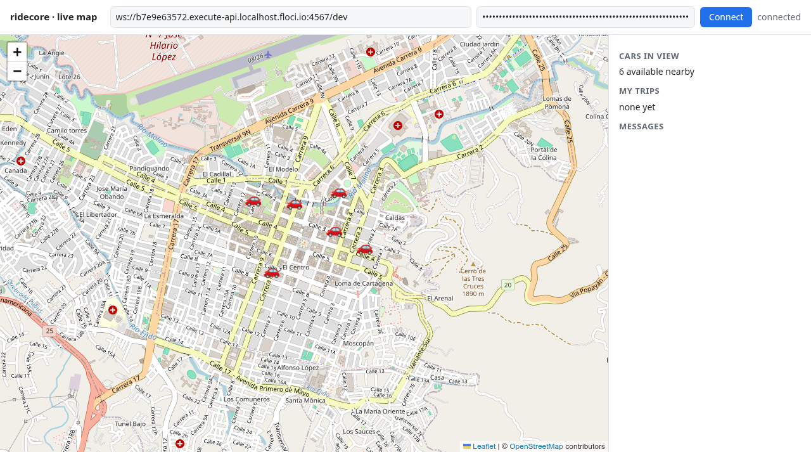

# ridecore

[](https://github.com/Chingal/ridecore/actions/workflows/ci.yml)

[](LICENSE)

The backend core of a ride-hailing service, event-driven and serverless on AWS (Node.js + TypeScript, Lambda,
DynamoDB, EventBridge, SQS, SNS, WebSocket), with an MCP server so AI agents can request trips. It runs locally
with one command, with no AWS account and no cost.

```bash
npm ci && make up && make demo     # needs Node.js 26 and Docker
```



Delivery is at-least-once: every queue has a dead-letter queue, and every consumer tolerates duplicates. The decisions behind this are in [`docs/decisions/`](#decisions).

## What it does today

- **Trip lifecycle as a state machine** (pure domain code, no AWS imports):
  `REQUESTED → ACCEPTED → DRIVER_ARRIVED → IN_PROGRESS → COMPLETED → RATED`, with `CANCELLED` allowed from
  the first three states. Any other transition is rejected.
- **HTTP API** for passengers and drivers: request, accept, arrive, start, complete, cancel and rate a trip;
  driver availability and position; a driver's open offers; a passenger's trip history.
- **Dispatch by proximity:** the nearest five available drivers in the same geohash cell (precision 5) or its
  neighbours get the offer (at most 20 offers per trip). When two drivers accept at the same time, one wins and the other gets `409 TRIP_ALREADY_TAKEN`.
- **One active trip per passenger and per driver**, enforced atomically with DynamoDB transactions
  (`TransactWriteItems`), not with a read-then-write check.
- **Transactional outbox:** every state change writes the trip and its versioned event (`schemaVersion: 1`)
  in the same transaction, so a transition can never be saved while its event is lost.
- **Idempotency keys** on mutating requests (`Idempotency-Key` header), scoped by role and caller, with expiry.
  The stored response is written in the same transaction as the business change.
- **Authorization per resource:** a passenger only sees and changes their own trips; a driver only acts on
  trips offered or assigned to them. JWT auth fails closed when the secret is missing or too short.
- **Event-driven consumers** ([ADR 0004](docs/decisions/0004-event-delivery.md)): a publisher reads the
  table stream and puts each outbox event on an EventBridge bus; rules route `trip.requested` to a dispatch
  queue and `trip.completed` to a billing queue. Dispatch offers the trip to nearby drivers and fans each
  offer out through SNS to a driver-offers queue; billing records the final fare. Every queue has a
  dead-letter queue, consumers report partial batch failures, and each consumer is idempotent
  (at-least-once delivery, duplicates are expected).
- **Real-time updates over WebSocket** ([ADR 0005](docs/decisions/0005-real-time.md)): API Gateway WebSocket
  API with the same JWT. Trip updates reach the trip's passenger and driver, new offers reach the driver,
  and passengers watching the map see available cars nearby (parked cars on opening, then their moves, throttled by geohash cell). Once a driver is
  on a trip, their position goes only to that trip's passenger. Pushes are driven by the events above; the
  real-time layer never writes trip state.
- **MCP server for AI agents** ([ADR 0003](docs/decisions/0003-mcp-tool-design.md)): four passenger tools
  (`request_trip`, `get_trip_status`, `cancel_trip`, `list_my_trips`) over stdio. It calls the HTTP API with
  one passenger token, so the API's authorization applies unchanged, and returns short trip summaries and
  readable errors such as `ACTIVE_TRIP_EXISTS: The passenger already has an active trip`.
- Structured JSON logs; every response carries an `x-correlation-id` header, and the same id travels in
  the event to every consumer's log lines.

## Code layout

The Lambdas run on the `nodejs24.x` runtime ([ADR 0001](docs/decisions/0001-toolchain-spike.md)); `make dev` serves the same HTTP handler on port 3000.

- `src/domain` — trip state machine, fare calculation (haversine distance), domain events and errors.
- `src/app` — use cases: trips, dispatch, drivers.
- `src/http` — routing, validation (zod), JWT auth (jose), responses, the Lambda entry point.
- `src/infra/dynamo` — repositories, single-table keys, transactions, idempotency and dedup stores.
- `src/events` — the outbox publisher, the SQS consumer harness and the consumers (dispatch, driver offers, billing, notifier).
- `src/realtime` — WebSocket routes, the message contract, the pusher and the positions stream handler.
- `src/mcp` — the MCP server: an HTTP client for the passenger routes, the four tools, the stdio entry point.
- `infra/cdk` — the stateful stack in AWS CDK: table, event bus, rules, SNS topic, queues and DLQs.
- `serverless.yml` — the Lambdas (API, publisher, consumers, WebSocket routes, positions) and their triggers, deployed with `osls`
  (the MIT fork of Serverless Framework). It reads the CDK outputs one way only (`scripts/cdk-env.ts`).

## Run it locally

Requirements: Node.js 26 (`.nvmrc`), Docker. AWS runs locally in [Floci](https://github.com/floci-io/floci),
an AWS emulator; nothing reaches a real AWS account.

```bash
npm ci
make up          # starts Floci, deploys the stateful stack (CDK) and the Lambdas (osls), seeds 6 drivers and 1 passenger
make demo        # one whole trip, step by step (see "See it work")
make e2e         # full trip flow against the Lambda deployed in Floci
make coverage    # unit-test coverage of src/
make demo-map    # live map: prints the URL and a token for demo/map.html, then moves the seeded cars
make dev         # same handler as a local server on port 3000
npm run token -- passenger <id>   # prints a dev JWT (make up also prints tokens for the seeded users)
make down
```

Configuration is read in this order: exported env > `.env.local` (yours, git-ignored) > `.env.deploy`
(generated by `make up`) > `.env.example`. Every value in `.env.example` is a non-secret local default.

## Tests and CI

| Level | What it covers | Command |
|---|---|---|
| Unit | domain, use cases, routing, validation, auth, repositories | `npm run test:unit` |
| Integration | repositories, dispatch races and idempotency against DynamoDB in Floci | `npm run test:integration` |
| Integration | consumers' idempotency, "offer once" under concurrency, DLQ redrive, connection and throttle items | `npm run test:integration` |
| End to end | a complete trip: the offer arrives only through the dispatch consumer, the fare only through billing; against the Floci-deployed Lambda and the local adapter | `make e2e`, `make e2e-local` |
| End to end | real time over WebSocket: a car on the map, the offer pushed to the driver, trip updates to both, the car leaving the map, the driver's position only to the passenger | `make e2e` |
| Load (local) | a rush hour with k6 against Floci (drivers moving, passengers watching and riding), then an invariant checker; behaviour under concurrency, not AWS capacity ([results](docs/load-testing.md)) | `make load PROFILE=peak` |
| End to end | the MCP server as a child process over stdio: request, one active trip only, status, list, cancel; a driver token and another passenger's trip are refused | `make e2e`, `make e2e-local` |

Unit-test coverage of `src/` (`make coverage`; integration and e2e tests are not counted): 61% of lines,
55% of branches. The CI job summary shows the current numbers on every run.

GitHub Actions runs lint, type checks, unit tests with coverage, `cdk synth`, `serverless package`, a dependency audit,
and then integration and e2e tests against Floci. CI needs no secrets and no AWS account. What e2e proves
is the behaviour through the deployed Lambda in Floci; that the infrastructure also deploys to real AWS is
only checked by synthesis and packaging.

## See it work

`make demo` runs one whole trip through the HTTP API deployed in Floci. The offer reaches the driver only
through the dispatch consumer, and the final fare only through the billing consumer. A real run:

```
[  0.2s] passenger-1 request      -> REQUESTED       v1  trip ee78e066, fare estimate 7402 COP
[  5.5s] driver-1    got the offer (through the dispatch consumer)
[  5.5s] driver-1    accept       -> ACCEPTED        v2
[  5.5s] driver-1    arrive       -> DRIVER_ARRIVED  v3
[  5.6s] driver-1    start        -> IN_PROGRESS     v4
[  5.6s] driver-1    complete     -> COMPLETED       v5
[  5.6s] passenger-1 rate 5       -> RATED           v6
[  5.6s] billing     final fare 7402 COP (through the billing consumer)
```

`make demo-map` drives the six seeded cars around small loops. It prints a WebSocket URL and a passenger token
to paste into `demo/map.html` (Leaflet + OpenStreetMap):



An AI agent can do the same through the MCP server. [`docs/mcp-example.md`](docs/mcp-example.md) shows a real
`claude -p` run that requests a trip, checks its status and cancels it.

## Use it from an AI agent

The MCP server runs on your machine and talks to the agent over stdio. It needs the API URL
(`RIDECORE_API_URL`, written to `.env.deploy` by `make up`; or `http://localhost:3000` with `make dev`)
and a passenger token (`make mcp-token` prints one for the seeded `passenger-1`; `PASSENGER=<id>` for another).

With [Claude Code](https://code.claude.com), from the repository root:

```bash
claude mcp add ridecore --env RIDECORE_MCP_TOKEN="$(make -s mcp-token)" \
  -- node --import "$PWD/scripts/load-env.ts" "$PWD/src/mcp/main.ts"
```

That uses the API in Floci (`RIDECORE_API_URL` from `.env.deploy`). To use the local server of `make dev`
instead, add `--env RIDECORE_API_URL=http://localhost:3000` before the `--`.

The command is `node` and not `npm run mcp`, because npm prints a banner to stdout and stdout carries only
the protocol. Any MCP client that starts a stdio server works the same way. Then ask, for example, *"Request
a trip from 2.4448, -76.6147 to 2.4594, -76.5996 and tell me its status"*: the agent calls `request_trip`
and gets back

```json
{"tripId":"…","state":"REQUESTED","origin":{"lat":2.4448,"lng":-76.6147},"destination":{"lat":2.4594,"lng":-76.5996},
 "fareEstimate":8202,"currency":"COP","driverAssigned":false,"createdAt":"…","timestamps":{"REQUESTED":"…"}}
```

The token is a 24-hour dev token; when it expires the tools answer `UNAUTHENTICATED` and you add the server
again with a new one.

## Watch an event fail and recover

`make dlq-demo` puts a `trip.completed` event with an unknown `schemaVersion` on the bus. The billing
consumer rejects it on every receive; SQS retries it every 60 s and, after the third receive, moves it
to the billing DLQ. Run on Floci:

```
Put trip.completed with schemaVersion 99 (correlationId dlq-demo-aadc8b20) on bus ridecore.
The billing consumer rejects it on each receive; SQS retries it every 60 s, 3 receives in total.
  t=  0s  billing in flight: 0  billing DLQ: 0
  t= 10s  billing in flight: 1  billing DLQ: 0
  ...
  t=180s  billing in flight: 1  billing DLQ: 0
  t=190s  billing in flight: 0  billing DLQ: 1
billing DLQ: 1 message(s). Move it back with: make redrive QUEUE=billing
```

`make redrive QUEUE=billing` moves the messages back to the queue (after deploying a fix, in real life).

## Watch the outbox reconciler recover a lost event

Every trip event is written to the outbox with a "pending" marker, and the stream publisher clears it once
EventBridge accepts the event. A scheduled `reconciler` Lambda publishes, every minute, any event still
pending after 60 s, so a stream record that is dropped or late does not leave a trip without its event
([ADR 0008](docs/decisions/0008-scaling.md), change 2). `make outbox-demo` switches the stream to the
publisher off, creates a trip and waits for its `trip.requested` on the bus; the stream is switched back on
at the end, also after an error or Ctrl-C. Run on Floci:

```
Stream to the publisher: disabled.
Created trip 14aee805-f95c-4da9-b31d-76b6f734ff36 at 2026-11-13T11:50:58.837Z. Its trip.requested is in the outbox, marked pending.
The stream is off, so only the reconciler (every minute, events older than 60 s) can publish it.
  t= 10s  waiting for trip.requested on the bus
  ...
  t= 90s  waiting for trip.requested on the bus
trip.requested published by the reconciler after 92 s.
Removed the temporary rule and queue.
Stream to the publisher: enabled.
```

## Decisions

- [ADR 0001 — Toolchain spike](docs/decisions/0001-toolchain-spike.md): why the Lambda runs on `nodejs24.x`,
  why `osls` instead of Serverless v4, and how CDK and osls deploy to Floci.
- [ADR 0002 — Dependency audit](docs/decisions/0002-dependency-audit.md): how audit findings are handled in CI.
- [ADR 0003 — MCP server tool design](docs/decisions/0003-mcp-tool-design.md): four task-shaped tools instead
  of one per endpoint, and when to add tool search or code execution.
- [ADR 0004 — Event delivery](docs/decisions/0004-event-delivery.md): outbox → stream → EventBridge → SQS
  with DLQs, SNS fan-out, idempotent consumers, the CDK/osls split, and the Floci spike behind it.
- [ADR 0005 — Real-time updates](docs/decisions/0005-real-time.md): WebSocket API, routing by actor, the three
  delivery patterns, client-side ordering, the map throttle, and the Floci spike behind it.
- [ADR 0006 — Single-table design](docs/decisions/0006-single-table-design.md): every access pattern and the key
  or index that serves it.
- [ADR 0007 — Idempotency and locking](docs/decisions/0007-idempotency-and-locking.md): Idempotency-Key,
  optimistic locking, and one active trip per passenger and per driver, each as one conditional transaction.
- [ADR 0008 — Scaling](docs/decisions/0008-scaling.md): what the local load test broke first (trip events behind
  driver positions in one stream) and the changes, cheapest first.
- [Design spec](docs/design/2026-11-09-ridecore-design.md) and the implementation plans:
  [core](docs/plans/2026-11-09-ridecore-core.md), [events](docs/plans/2026-11-10-ridecore-events.md),
  [real time](docs/plans/2026-11-11-ridecore-realtime.md), [MCP](docs/plans/2026-11-11-ridecore-mcp.md),
  [README and demo](docs/plans/2026-11-11-ridecore-readme.md), [load](docs/plans/2026-11-11-ridecore-load.md).

## Scaling track

How this system grows from thousands to millions of users, one measured decision at a time:

1. **ridecore-location** (Go): driver positions, the nearby query and the live map, out of the trip
   table, with Redis and Kafka. It is switched on with `RIDECORE_LOCATION_URL`; with the switch off,
   ridecore runs exactly as before. Code in
   [ridecore-location](https://github.com/Chingal/ridecore-location); before/after numbers in
   [ADR 0008](docs/decisions/0008-scaling.md#results-change-6-built-2026-11-11).
2. **Outbox reconciler**: every trip event is marked pending until it is on the bus, and a scheduled
   Lambda publishes any event the table stream dropped or delayed, about a minute later. See
   `make outbox-demo` above and [ADR 0008](docs/decisions/0008-scaling.md#results-change-2-built-2026-11-13).
3. Next: batch matching at peak, and the peak load rerun with the reconciler in place.

## Status and limitations

Built and tested: the trip API and data model, the event path, real-time updates, the MCP server, and this
documentation with its demo.

- Only `STANDARD` trips, with the fare from the straight-line distance.
- An unaccepted trip waits until the passenger cancels: there is no expiry and no re-offer.
- Auth is a minimal JWT stand-in, not production identity.
- All functions share one IAM role (ADR 0004, ADR 0005).
- Under a local rush hour, trip events wait behind driver positions in the table stream. On Floci they were
  lost; on AWS they would be delayed ([ADR 0008](docs/decisions/0008-scaling.md)). The fixes are listed but not built.

## Background

ridecore is inspired by a ride-hailing platform the author designed and built in 2016-2018. This is a new
codebase written from scratch in 2026. It contains no code, names or data from that platform, and it reuses
only knowledge of the domain.

## License

[MIT](LICENSE) © 2026 Rodrigo Chingal
